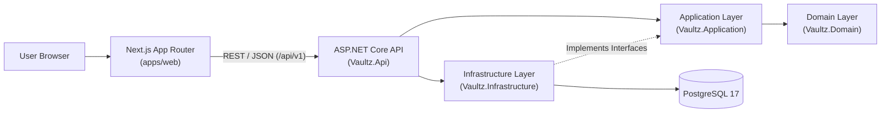
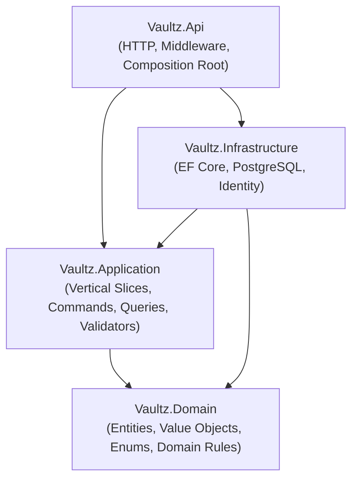

# Vaultz — Architecture Overview

## 1. System Topology

Vaultz is architected as a **Modular Monolith** with a clear separation between a Next.js web client (`apps/web`), an ASP.NET Core Web API (`apps/api`), and a relational PostgreSQL database (`infrastructure/docker`).

---

## 2. Responsibilities by Tier

### Frontend (`apps/web`)
- Renders the application shell, navigation, and dashboards using Next.js App Router Server Components and interactive Client Components.
- Organizes domain UI by feature (`src/features/accounts`, `transactions`, `budgets`, `categories`, `savings`, `reports`).
- Communicates with the backend exclusively over the versioned `/api/v1` REST API via a centralized typed HTTP client (`src/lib/api/client.ts`).
- Performs UX-focused form validation using React Hook Form + Zod without duplicating authoritative backend domain rules.

### Backend API (`apps/api`)
- Exposes RESTful HTTP endpoints under `/api/v1`, handles authentication/authorization, validates requests via FluentValidation, executes vertical-slice command and query handlers, and returns standardized responses (`ProblemDetails` on error).
- Enforces multi-user data isolation, monetary calculation accuracy (`decimal`), and transactional integrity across persistence operations.

### Database (`PostgreSQL`)
- Persists user accounts, financial accounts, transactions, transfers, categories, budgets, and savings goals with strict relational integrity, foreign keys, check constraints, and exact `numeric(19, 4)` columns.

---

## 3. Why a Modular Monolith?

1. **Transactional Consistency:** Personal finance operations (such as recording a transaction and updating an account balance, or transferring money between two accounts) require ACID transactions within a single relational database—not eventual consistency across distributed microservices.
2. **Operational Simplicity:** A single deployable API and a single PostgreSQL database eliminate network hops, distributed tracing overhead, and message broker complexity while the domain evolves.
3. **Strong Internal Boundaries:** Combining Clean Architecture dependency rules with Vertical Slice feature folders provides the modularity needed to keep features decoupled and testable.

---

## 4. Clean Architecture Dependency Direction

- **`Vaultz.Domain`** has zero outward project dependencies.
- **`Vaultz.Application`** depends only on `Vaultz.Domain` and defines interfaces (`IVaultzDbContext`, etc.) implemented by outer layers.
- **`Vaultz.Infrastructure`** depends on `Vaultz.Application` and `Vaultz.Domain` to implement persistence and external services.
- **`Vaultz.Api`** references `Vaultz.Application` and `Vaultz.Infrastructure` to compose dependency injection and expose HTTP endpoints.

---

## 5. Security Assumptions & Current Limitations (v0.1)

- **Implemented in v0.1:**
  - Explicit CORS policy restricted to configured frontend origins (`AllowedOrigins`).
  - Global exception handling (`GlobalExceptionHandler`) returning sanitized RFC 9457 `ProblemDetails` without exposing stack traces outside Development.
  - Parameterized database access via EF Core (`VaultzDbContext`).
  - Environment-driven secrets with `.env` excluded from Git and placeholder-only `.env.example` files.
- **Planned for Milestone 2 (Not Yet Active):**
  - ASP.NET Core Identity authentication endpoints, session/cookie issuing, password policy enforcement, and `[Authorize]` user-scoped filters on financial endpoints.
  - Rate limiting and production TLS termination configuration.
